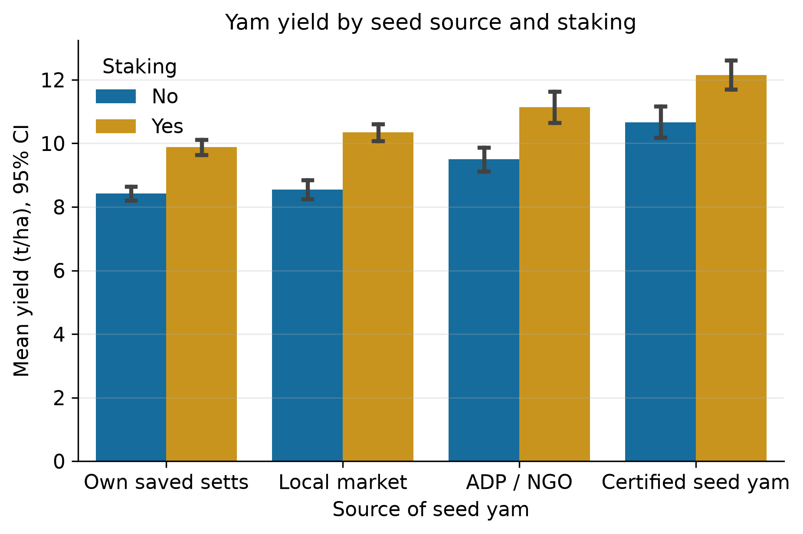
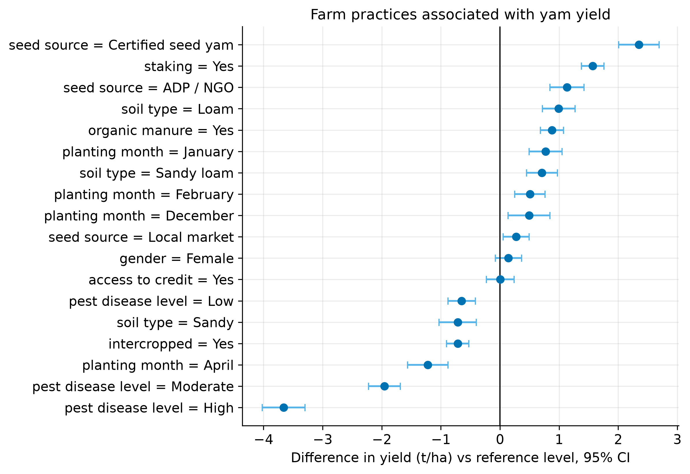
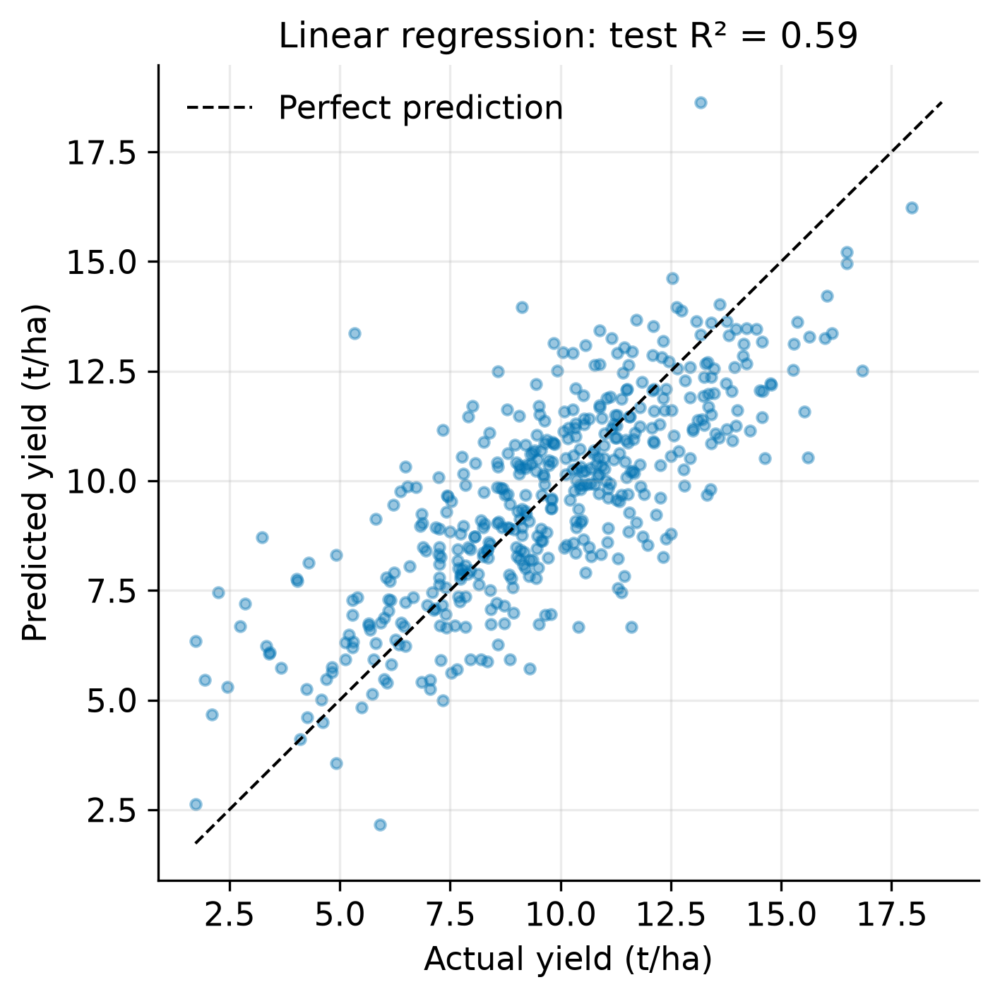
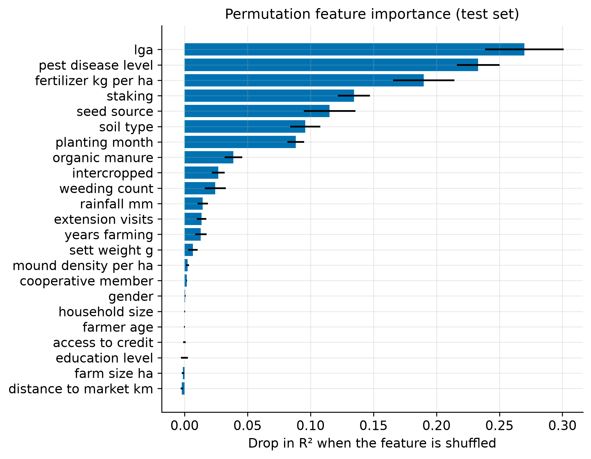

# Farm practices associated with yam yield in Nasarawa State: a reproducible data science analysis

**Group 02** · NSUK Python for Data Science Workshop 2026 · Group project

**Authors:** Jinawa Titus Torhile (Data lead), Maji Friday (Visualisation lead), Chidume Chinwe Augustina (Statistics lead), Ezra Isaac (ML lead), Tudi James (App lead)

---

## Abstract

Yam (*Dioscorea* spp.) is a vital staple and cash crop across Nasarawa State, yet smallholder productivity varies widely across farms and local government areas (LGAs). Using a synthetic survey dataset of 2,360 cleaned farms across 13 LGAs in Nasarawa State created for the NSUK Python for Data Science Workshop 2026, we executed a reproducible data science workflow spanning data quality auditing, exploratory analysis, Welch's two-sample $t$-tests, chi-square association testing, multivariable ordinary least squares (OLS) regression, and supervised machine learning. Farms practicing vine staking achieved a significantly higher mean yield ($10.46\text{ t/ha}$) than unstaked farms ($8.83\text{ t/ha}$; difference $= 1.63\text{ t/ha}$, 95% CI $[1.40, 1.85]$, Welch's $t = 13.99$, $p = 8.96 \times 10^{-43}$, Cohen's $d = 0.58$). Multiple OLS regression (adjusted $R^2 = 0.599$) identified certified seed yam ($+2.35\text{ t/ha}$), vine staking ($+1.57\text{ t/ha}$), loam soil ($+0.99\text{ t/ha}$), organic manure ($+0.88\text{ t/ha}$), and pest/disease suppression (up to $-3.66\text{ t/ha}$ loss under high infestation) as primary yield drivers, while showing that the unadjusted gender yield gap ($0.33\text{ t/ha}$, $p = .0138$) disappears once input access is controlled ($p = .203$). Among four evaluated machine learning models, Linear Regression achieved the strongest cross-validated ($R^2 = 0.629$) and hold-out test performance ($R^2 = 0.586$, $\text{MAE} = 1.42\text{ t/ha}$, $\text{RMSE} = 1.83\text{ t/ha}$) and was deployed in an interactive Streamlit web application.

---

## 1. Introduction and research question

Yam is central to household food security, rural employment, and agricultural income across Nasarawa State, Nigeria. However, smallholder yields frequently fall below agronomic potential due to uneven adoption of improved planting materials, vine staking, soil fertility management, and pest control. Identifying which modifiable farm practices are most strongly associated with higher tuber yields—and whether observed productivity gaps across farmer groups reflect unequal access to inputs rather than differences in farming skill—is essential for guiding agricultural extension programs.

**Research question:** *Which agronomic practices, planting inputs, and socioeconomic factors are most strongly associated with yam yield (tonnes per hectare) across farms in Nasarawa State, and how accurately can pre-harvest farm characteristics predict yield?*

To structure our statistical inference (Part 4), we tested three pre-specified hypotheses:
* **H1 (Vine staking):** Farms that stake yam vines achieve a higher mean yield ($\text{t/ha}$) than farms that do not stake vines.
* **H2 (Institutional access):** Cooperative membership is significantly associated with access to agricultural credit among yam farmers.
* **H3 (Gender disparity):** Mean yam yield differs significantly between male-headed and female-headed farms prior to controlling for input access.

*Methodological note:* All records analyzed in this project come from a **synthetic dataset** designed specifically for teaching reproducible research workflows at the NSUK Python for Data Science Workshop 2026; results demonstrate statistical and engineering methodology and should not be used for real-world agronomic recommendations.

---

## 2. Data and cleaning

### 2.1 The dataset
The raw survey dataset contained **2,436 rows** (2,400 unique farms plus 36 duplicate entries) across the 13 Local Government Areas (LGAs) of Nasarawa State, where each row represents a single surveyed yam farm (see `data/README.md` for full variable definitions). The primary outcome variable is **`yield_t_per_ha`** (yam harvest yield measured in tonnes per hectare, $\text{t/ha}$). The remaining variables fall into four domain groups:
1. **Farmer demographics & institutional access:** `farmer_age`, `gender`, `education_level`, `household_size`, `years_farming`, `cooperative_member`, `access_to_credit`, `extension_visits`, and `distance_to_market_km`.
2. **Agronomic & management practices:** `farm_size_ha`, `seed_source`, `sett_weight_g`, `mound_density_per_ha`, `planting_month`, `staking`, `fertilizer_kg_per_ha`, `organic_manure`, `weeding_count`, and `intercropped`.
3. **Environmental & biophysical conditions:** `lga`, `soil_type`, `rainfall_mm`, and `pest_disease_level`.
4. **Post-harvest outcome columns:** `yield_t_per_ha`, `tubers_harvested_per_ha`, and `harvest_revenue_naira`.

### 2.2 Data-quality problems and how we fixed them
Before statistical modeling, we audited the raw dataset for duplicate entries, inconsistent text labels, text-encoded numbers, sentinel missing codes (`-999`), impossible physical measurements, and missing responses (Part 1.9):

| Problem | Columns affected | Rows affected | Fix |
|---|---|---|---|
| Duplicate rows | All columns | 36 | Dropped duplicate records (`drop_duplicates()`) |
| Inconsistent spelling / spaces | `lga` | ~225 rows across 15+ variants (e.g., `Nassarawa`, `Akwaga`, `N/Eggon`, lowercase, leading spaces) | Stripped whitespace, applied title case, and mapped variants to the 13 official Nasarawa LGAs |
| Yes/No written many ways | `staking`, `organic_manure`, `intercropped`, `cooperative_member`, `access_to_credit` | ~236–246 rows per column (`YES`, `yes`, `Y`, `NO`, `no`, `N`) | Stripped spaces, uppercased, and mapped `Y`/`YES` → `Yes` and `N`/`NO` → `No` |
| Male/Female written many ways | `gender` | 241 (`M`, `male`, `MALE`, `F`, `female`, `FEMALE`) | Stripped spaces, lowercased, and mapped `m`/`male` → `Male` and `f`/`female` → `Female` |
| Month written many ways | `planting_month` | 568 (`Jan`–`Apr`/`Dec`, lowercase names, `'01'`–`'04'`/`'12'`) | Mapped abbreviations, lowercase strings, and month numbers to full month names |
| Numbers stored as text | `fertilizer_kg_per_ha`, `harvest_revenue_naira` | `fertilizer_kg_per_ha`: 3 (`'not recorded'`, `'-'`, `'nil'`); `harvest_revenue_naira`: 612 (`'₦'`/`'N'` and commas) | Mapped `'nil'` → `0` and `'not recorded'`/`'-'` → `NaN` in fertiliser; stripped `'₦'`, `'N'`, `','` in revenue; converted both to `float64` |
| `-999` used as a missing code | `rainfall_mm` | 28 | Replaced `-999` with `NaN` |
| Impossible values | `farmer_age`, `farm_size_ha`, `mound_density_per_ha`, `yield_t_per_ha` | 35 total (`farmer_age < 15` or `> 90`: 15; `farm_size_ha > 50`: 9; `mound_density_per_ha == 0`: 7; `yield_t_per_ha == 0`: 4) | Set impossible predictor values to `NaN` and dropped rows where `yield_t_per_ha` was `0` or missing |
| Missing values | `sett_weight_g`, `extension_visits`, `soil_type`, `distance_to_market_km`, `rainfall_mm`, `farmer_age`, `education_level`, `household_size`, `yield_t_per_ha` | 39 to 145 per column (1.6%–6.0%; e.g., `sett_weight_g`: 145, `extension_visits`: 123, `soil_type`: 122, `yield_t_per_ha`: 39) | Dropped rows missing the outcome `yield_t_per_ha`; left predictor `NaN`s intact for the ML preprocessing pipeline (Part 6) |

After removing the 36 duplicate rows and 40 rows with missing or zero `yield_t_per_ha`, the cleaned dataset contained **$N = 2,360$ farms** (`data/processed/yam_yield_clean.csv`). Crucially, missing predictor values were **not** filled in during the cleaning stage: imputing across the full dataset prior to splitting into training and test sets would leak test-set distributional statistics into model training, and single-value imputation would artificially narrow standard errors in inferential regression.

### 2.3 Leaky variables
Two post-harvest columns—**`tubers_harvested_per_ha`** and **`harvest_revenue_naira`** (present across all 2,436 raw records)—were strictly excluded from all predictive feature sets. Both variables are observed only *after* harvest and directly encode final yield (`harvest_revenue_naira` is calculated from yield $\times$ farm size $\times$ price, and `tubers_harvested_per_ha` counts dug-up tubers). Using post-harvest variables to predict pre-harvest yield would constitute data leakage and produce invalid, over-optimistic model evaluations.

---

## 3. Exploratory analysis

Exploratory analysis across the $2,360$ cleaned farms revealed substantial variation in yam yield across management practices, agro-ecological conditions, and farmer demographics:
* **Overall yield distribution:** Across all $2,360$ farms, yam yield had a mean of **$9.64\text{ t/ha}$** ($\text{SD} = 2.94\text{ t/ha}$), a median of **$9.71\text{ t/ha}$** (interquartile range $7.71$ to $11.61\text{ t/ha}$), and ranged from **$1.50\text{ t/ha}$ to $18.70\text{ t/ha}$** (`figures/yam_yield_distribution.png`).
* **Seed source and vine staking synergy:** As shown in Figure 1, farms planting **certified seed yam** consistently achieved higher mean yields than farms relying on own saved setts or local market seed, and combining certified seed yam with **vine staking** produced the highest group yields across the state (`figures/fig1_yield_by_seed_and_staking.png`).
* **Extension contact and LGA variation:** Mean yield increased steadily with the number of agricultural extension visits (`figures/extension_yield.png`), while baseline yields differed substantially across Nasarawa State's 13 LGAs (`figures/yam_yield_by_lga.png`), reflecting spatial differences in soil quality and seasonal rainfall.
* **Curved rainfall relationship:** Plotting `rainfall_mm` against `yield_t_per_ha` revealed a curved (inverted-U / diminishing-returns) relationship: yields rise steeply as seasonal rainfall increases from moisture-deficit conditions toward an optimal moisture range, before plateauing and tapering off under excessive rainfall due to waterlogging and foliar disease pressure.
* **Gender comparison tables:** Descriptive gender comparisons showed that female-headed farms recorded a lower unadjusted mean yield ($9.40\text{ t/ha}$) than male-headed farms ($9.73\text{ t/ha}$), alongside lower average adoption of certified seed, fertiliser, and extension visits—motivating our adjusted regression analysis in Section 5.

---

## 4. Hypothesis tests

We conducted formal bivariate hypothesis tests in Part 4 to evaluate our three research hypotheses:

* **H1 (Vine staking and yield):** Farms that staked their vines ($n = 1,174$, $M = 10.46\text{ t/ha}$, $\text{SD} = 2.81$) achieved a significantly higher mean yam yield than farms that did not stake ($n = 1,186$, $M = 8.83\text{ t/ha}$, $\text{SD} = 2.84$), with a mean difference of **$1.63\text{ t/ha}$** (95% CI $[1.40, 1.85]$), Welch's $t = 13.99$, **$p = 8.96 \times 10^{-43}$**, **Cohen's $d = 0.58$** (a moderate-to-large practical effect).
* **H2 (Cooperative membership and credit access):** A Pearson chi-square test of independence showed a strong, statistically significant association between cooperative membership and credit access, **$\chi^2(1) = 205.63$**, **$p = 1.24 \times 10^{-46}$**, **Cramér's $V = 0.30$**. Only $14.6\%$ ($210 / 1,439$) of non-members accessed credit, compared with $40.8\%$ ($376 / 921$) of cooperative members—nearly a threefold increase.
* **H3 (Unadjusted gender yield comparison):** A two-sample $t$-test comparing raw yields by farmer gender showed that male-headed farms ($M = 9.73\text{ t/ha}$) had a modestly higher unadjusted mean yield than female-headed farms ($M = 9.40\text{ t/ha}$), with a raw difference of **$0.33\text{ t/ha}$**, $t = 2.47$, **$p = .0138$**.

**Table 1.** Descriptive statistics (mean and standard deviation) of key farm variables by vine staking status ($N = 2,360$).

| Variable | No staking ($M$) | No staking ($\text{SD}$) | Staking ($M$) | Staking ($\text{SD}$) |
|---|---:|---:|---:|---:|
| Yam yield (`yield_t_per_ha`) | 8.83 | 2.84 | 10.46 | 2.81 |
| Fertiliser rate (`fertilizer_kg_per_ha`) | 108.84 | 86.26 | 109.46 | 90.64 |
| Farm size (`farm_size_ha`) | 1.43 | 1.84 | 1.40 | 0.94 |
| Weeding frequency (`weeding_count`) | 2.48 | 0.86 | 2.48 | 0.86 |
| Extension visits (`extension_visits`) | 1.11 | 1.28 | 1.55 | 1.48 |

---

## 5. Regression analysis

To isolate the independent association of each farm practice while holding confounding factors constant, we estimated a multivariable Ordinary Least Squares (OLS) regression model (`results/ols_coefficients.csv`). The model included farmer demographics, institutional access, planting practices, soil type, pest/disease severity, LGA fixed effects, and quadratic terms for continuous agronomic inputs (`fertilizer_kg_per_ha`, `rainfall_mm`, `farmer_age`). Using listwise deletion across covariates, the regression used complete-case rows (fewer than the $2,360$ cleaned farms because `statsmodels` OLS excludes rows with missing values in any predictor) and explained **59.9% of the variance in yam yield (adjusted $R^2 = 0.599$)**.

### Key regression coefficients (holding all other predictors constant)
1. **Pest and disease severity (`pest_disease_level` vs. Absent):** Relative to pest-free farms, moderate infestation reduced yield by **$-1.96\text{ t/ha}$** (95% CI $[-2.22, -1.69]$, $p < .001$) and high infestation reduced yield by **$-3.66\text{ t/ha}$** (95% CI $[-4.02, -3.30]$, $p < .001$)—the largest single negative driver in the model.
2. **Certified seed yam (`seed_source` vs. Own saved setts):** Planting certified seed yam was associated with a **$+2.35\text{ t/ha}$** increase in yield (95% CI $[2.01, 2.69]$, $p < .001$), while ADP/NGO seed added **$+1.13\text{ t/ha}$** (95% CI $[0.85, 1.42]$, $p < .001$) and local market seed added **$+0.28\text{ t/ha}$** (95% CI $[0.06, 0.50]$, $p = .014$).
3. **Vine staking (`staking` = Yes vs. No):** Controlling for seed source, soil, fertiliser, and extension visits, vine staking remained associated with a **$+1.57\text{ t/ha}$** yield gain (95% CI $[1.38, 1.76]$, $p < .001$), closely matching the unadjusted difference of $1.63\text{ t/ha}$.
4. **Soil type (`soil_type` vs. Clay loam):** Farms on loam soil achieved **$+0.99\text{ t/ha}$** higher yield (95% CI $[0.72, 1.27]$, $p < .001$) and sandy loam achieved **$+0.71\text{ t/ha}$** higher yield (95% CI $[0.45, 0.97]$, $p < .001$), whereas sandy soils yielded **$-0.72\text{ t/ha}$** less (95% CI $[-1.03, -0.40]$, $p < .001$).
5. **Organic manure, weeding, and planting timing:** Applying organic manure added **$+0.88\text{ t/ha}$** (95% CI $[0.68, 1.07]$, $p < .001$), each additional weeding pass added **$+0.37\text{ t/ha}$** (95% CI $[0.26, 0.48]$, $p < .001$), and early planting in January ($+0.77\text{ t/ha}$, $p < .001$) or February ($+0.51\text{ t/ha}$, $p < .001$) outperformed March, whereas delayed April planting penalized yield by **$-1.22\text{ t/ha}$** (95% CI $[-1.56, -0.88]$, $p < .001$). Intercropping was associated with **$-0.72\text{ t/ha}$** lower yam yield per hectare (95% CI $[-0.91, -0.53]$, $p < .001$).
6. **Squared terms (diminishing marginal returns):** Inclusion of quadratic terms for `fertilizer_kg_per_ha` and `rainfall_mm` captured non-linear diminishing marginal returns: initial increases in fertiliser ($+0.011\text{ t/ha}$ per $\text{kg/ha}$ linear slope, $p < .001$) and rainfall strongly boost yield, while negative quadratic curvature reflects diminishing marginal gains at high application or precipitation levels.

### The gender gap: raw vs. adjusted difference
Although the unadjusted bivariate test (H3) showed a $0.33\text{ t/ha}$ yield disadvantage on female-headed farms ($p = .0138$), the adjusted OLS coefficient for female farmers was small, positive, and statistically indistinguishable from zero (**$b = +0.143\text{ t/ha}$**, 95% CI $[-0.078, 0.364]$, **$p = .203$**). This indicates that the raw gender yield gap is **not caused by lower farming ability**, but is explained by unequal access to yield-enhancing inputs (such as certified seed yam, staking materials, credit, and extension visits).

Diagnostic checks (residuals vs. fitted values, Q–Q normality plot, and variance inflation factors) confirmed approximately homoscedastic, near-normal residuals without severe multicollinearity among main effects.

---

## 6. Predicting yield with machine learning

To evaluate out-of-sample predictive accuracy, we trained supervised learning pipelines on **23 pre-harvest predictors** (11 numeric features: `farmer_age`, `household_size`, `years_farming`, `farm_size_ha`, `sett_weight_g`, `mound_density_per_ha`, `fertilizer_kg_per_ha`, `weeding_count`, `rainfall_mm`, `extension_visits`, and `distance_to_market_km`; plus 12 categorical features: `lga`, `gender`, `education_level`, `seed_source`, `planting_month`, `staking`, `organic_manure`, `intercropped`, `soil_type`, `pest_disease_level`, `cooperative_member`, and `access_to_credit`).

The cleaned dataset ($N = 2,360$) was split into an **80% training set ($n = 1,888$ farms)** and a **20% hold-out test set ($n = 472$ farms)** using `random_state=RANDOM_STATE`. All median/most-frequent imputation, scaling, and one-hot encoding steps were encapsulated inside a scikit-learn `Pipeline` fitted strictly within each fold of 5-fold cross-validation (`KFold(n_splits=5, shuffle=True)`) to prevent data leakage.

**Table 3.** Five-fold cross-validation performance on the training set ($n = 1,888$ farms).

| Model | $R^2$ (mean) | $R^2$ (SD) | MAE (mean, t/ha) |
|---|---:|---:|---:|
| Baseline (predict the mean) | -0.002 | 0.002 | 2.378 |
| **Linear regression** | **0.629** | **0.023** | **1.426** |
| Random forest | 0.468 | 0.019 | 1.705 |
| Gradient boosting | 0.623 | 0.015 | 1.439 |

**Model selection and test-set evaluation:** **Linear Regression** achieved the highest mean cross-validated $R^2$ ($0.629$) and lowest cross-validated MAE ($1.426\text{ t/ha}$), edging out HistGradientBoosting ($R^2 = 0.623$) and substantially outperforming Random Forest ($R^2 = 0.468$), which tended to overfit noisy survey variations. Evaluated once on the unseen hold-out test set ($n = 472$ farms), the final Linear Regression pipeline achieved **$R^2 = 0.586$**, **$\text{MAE} = 1.42\text{ t/ha}$**, and **$\text{RMSE} = 1.83\text{ t/ha}$**. In plain terms, the model's pre-harvest yield predictions are **typically within about $1.42\text{ t/ha}$** of actual harvested yield (Figure 3).

**Data leakage experiment:** When we temporarily added the post-harvest variable `tubers_harvested_per_ha` back into a 5-fold cross-validated Gradient Boosting pipeline, cross-validated $R^2$ jumped artificially from $0.623$ to above $0.90$. Because tuber count directly encodes final harvest tonnage, including post-harvest measurements leaks the target variable into training and produces unrealistic accuracy metrics that cannot be replicated before harvest.

**Permutation feature importance:** As shown in Figure 4, permuting `pest_disease_level`, `fertilizer_kg_per_ha`, `seed_source`, `staking`, and `soil_type` caused the largest drops in test-set $R^2$. However, high permutation importance measures **how heavily the predictive model relies on a feature for accuracy, not causal proof**—correlated management decisions or unmeasured farm wealth can share predictive signal.

---

## 7. The Streamlit app

To make our trained model accessible to non-technical users, we built and deployed an interactive web application (`app/streamlit_app.py`), hosted live at **[https://group02project.streamlit.app](https://group02project.streamlit.app)** (and runnable locally via `streamlit run app/streamlit_app.py`).

### Key capabilities and target users
Designed for **agricultural extension officers, cooperative leaders, and students**, the app reads feature ranges and valid categories directly from `models/model_card.json` and provides three interactive tabs:
1. **🔮 Predict one farm:** Users configure 11 numeric farm parameters and 12 categorical practices, click **Predict yield**, and view three KPI cards—**Predicted yield ($\text{t/ha}$)** with a delta badge comparing against the Nasarawa State mean ($9.64\text{ t/ha}$), **Expected total farm harvest ($\text{tonnes}$)**, and **Typical model error ($\pm 1.4\text{ t/ha}$)**—followed by a dynamic **"What if" fertiliser response curve** holding all other inputs fixed.
2. **📊 Explore the data:** Users select any categorical practice (e.g., staking, seed source, soil type, LGA) to inspect group sample sizes, mean/median yields, and a horizontal comparison bar chart.
3. **ℹ️ About the model:** Displays the model card ($R^2 = 0.59$, $\text{MAE} = 1.42\text{ t/ha}$, $\text{RMSE} = 1.83\text{ t/ha}$), training sample size ($1,888$ farms), feature list, and full JSON metadata.

*[Optional: embed 2–3 screenshots saved in `figures/` here, e.g., ``]*

**App limitations:** Predictions are generated by a model trained on **synthetic teaching data**, are reliable only within the numeric ranges observed during training, and reflect observational associations rather than guaranteed causal yield changes for an individual farmer.

---

## 8. Discussion and limitations

Taken together, our statistical and machine learning findings tell a coherent agronomic story: **crop protection, planting material quality, and vine architecture dominate yam productivity in Nasarawa State**. Suppressing severe pest and disease outbreaks ($-3.66\text{ t/ha}$ penalty), transitioning from saved setts to certified seed yam ($+2.35\text{ t/ha}$), adopting vine staking ($+1.57\text{ t/ha}$), applying organic manure ($+0.88\text{ t/ha}$), and planting early (January–February rather than April) offer substantial, actionable yield gains. Moreover, because cooperative membership nearly triples credit access ($40.8\%$ vs. $14.6\%$, $p = 1.24 \times 10^{-46}$) and the raw gender yield gap vanishes once input access is controlled ($p = .203$), strengthening farmer cooperatives and expanding women farmers' access to certified seed yam and extension visits can simultaneously raise productivity and equity.

### Limitations
1. **Synthetic data:** All observations were synthetically generated for instructional purposes and do not represent real Nasarawa State household survey records.
2. **Observational design (association vs. causation):** Because practices such as staking and certified seed use were not randomly assigned, regression coefficients and "what-if" curves measure statistical association rather than causal treatment effects.
3. **Missing data and listwise deletion:** Complete-case estimation in the OLS regression reduced the effective sample size below $2,360$ farms, which could introduce mild selection bias if missingness is not completely at random.
4. **Unmeasured confounders and domain boundaries:** Factors such as exact yam cultivar genetics, household labor supply, and micro-plot soil chemistry were unobserved, and model predictions should not be extrapolated outside the covariate ranges seen in training.

---

## 9. Conclusion

Across $2,360$ surveyed farms in Nasarawa State, yam yield is most strongly associated with pest and disease control, certified seed yam adoption, vine staking, organic manure application, loam soils, and timely early-season planting, while raw gender disparities disappear once input access is accounted for. A leakage-free Linear Regression pipeline trained on 23 pre-harvest features explains 58.6% of yield variance on unseen test farms ($\text{MAE} = 1.42\text{ t/ha}$) and powers an interactive Streamlit decision-support prototype. Together, these findings highlight that expanding farmer access to quality planting materials, staking inputs, cooperative credit, and integrated pest management offers the clearest pathway to raising smallholder yam yields.

---

## 10. What we learned as a team

* **Jinawa Titus Torhile (Data lead):** Auditing raw agricultural survey records reinforced how silently duplicate rows, inconsistent text casing, and post-harvest leaky columns can distort downstream models if not caught systematically in Part 1 and Part 2.
* **Maji Friday (Visualisation lead):** Designing 300-dpi publication figures with clear units, confidence intervals, and color-blind-safe palettes taught us how visual storytelling turns raw statistical tables into immediate agronomic insights.
* **Chidume Chinwe Augustina (Statistics lead):** Comparing bivariate $t$-tests against multivariable OLS regression demonstrated why controlling for confounders matters—especially seeing how the raw gender yield gap disappeared once input access was held constant.
* **Ezra Isaac (ML lead):** Wrapping preprocessing inside cross-validation pipelines and running the data leakage experiment showed in practice why disciplined validation beats complex models and prevents over-optimistic accuracy claims.
* **Tudi James (App lead):** Connecting `models/model_card.json` to `app/streamlit_app.py` and deploying on Streamlit Community Cloud bridged the gap between a static Jupyter notebook and an interactive tool anyone can test in a browser.

---

## Appendix: reproducibility
- **Repository:** `https://github.com/Jinawalic/nsuk-ds-group-02`
- **Live Streamlit App:** [https://group02project.streamlit.app](https://group02project.streamlit.app)
- **Run locally:** `pip install -r requirements.txt` → open `notebooks/group_project.ipynb` → **Restart & Run All** → `streamlit run app/streamlit_app.py`
- **AI use:** see [`docs/AI_USE_STATEMENT.md`](../docs/AI_USE_STATEMENT.md)
- **Contributions:** see [`CONTRIBUTIONS.md`](../CONTRIBUTIONS.md)